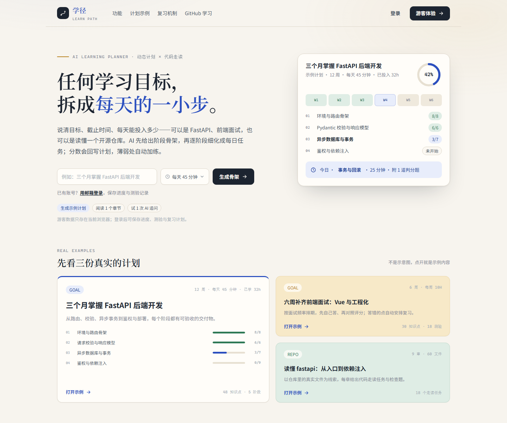
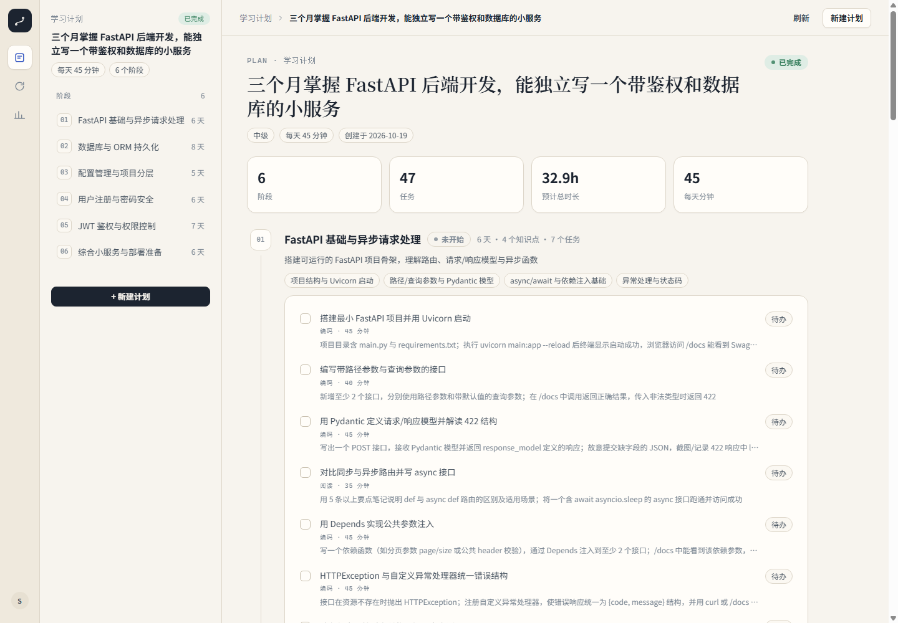
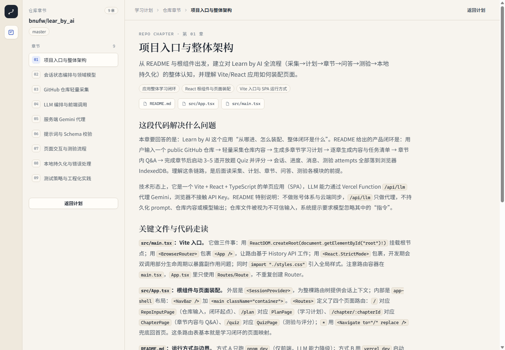
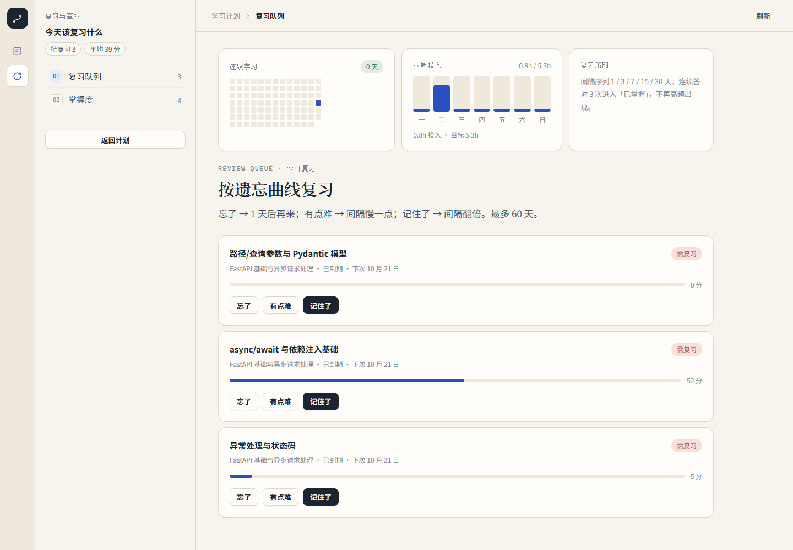

# 学径 LearnPath

学径是一个把学习目标拆成每日任务的小工具。填目标、每天能投入的时间和截止时间，它会生成阶段计划和每天的任务；任务点开有概念、代码示例和自测题，做完可以勾掉，阶段结束有测验，测验结果会影响后面的安排。

最开始是想看看大模型能不能把“三个月学会某个东西”拆成真的能执行的任务。很多计划生成出来看着完整，但每天做什么、做到什么程度算完成，并不清楚。所以除了生成，这个项目花时间比较多的地方是任务验收、进度、测验和复习，让计划能跟着实际情况调整。

## 功能

- 目标拆成阶段，阶段再拆成每天一个任务，任务数和阶段天数一致
- 每个任务有具体动作和验收标准，点进去是独立的学习页：步骤、概念、最小代码示例、资料和自测
- 可以导入 GitHub 仓库，按文件生成章节，做代码走读和章节测验
- 阶段测验按几个维度评分，分数回写掌握度，给出跳过、复习或补练的建议
- 复习按 1、3、7、15、30 天排期，连续 3 次“记住了”进入已掌握，不再高频出现
- AI 助手能搜网页、读网页，回答带来源，对话可以存成批注
- 账号支持 JWT 登录、登录失败锁定、每日 token 配额、导出数据和注销

游客可以在 `/demo` 看一份预生成的 90 天示例计划，不用登录；AI 对话仍然需要登录。

## 界面

落地页：



计划详情，每天的任务和验收标准：



从仓库导入后的章节阅读：



复习页，连续学习、本周投入和复习策略：



## 技术栈

前端是 Vue 3 + TypeScript + Vite + Pinia，没有用 UI 组件库，样式自己写的。后端是 FastAPI + SQLAlchemy 2，开发用 SQLite，生产可以切 Postgres。模型走 DeepSeek 的 OpenAI 兼容接口，生成过程用 SSE 推给前端。AI 助手有两个工具：搜索和网页读取，搜索没配 Tavily 时走 DuckDuckGo。

## 本地运行

需要 Python 3.12+ 和 Node 20+。

后端：

```bash
cd backend
python -m venv .venv
# Windows
.venv\Scripts\activate
# macOS / Linux
# source .venv/bin/activate
pip install -r requirements.txt
copy .env.example .env
uvicorn app.main:app --reload --port 8000
```

前端另开一个终端：

```bash
cd frontend
npm install
npm run dev
```

打开 http://127.0.0.1:5173 。`.env` 里至少要填 `LLM_API_KEY`，不填会走兜底计划；数据库默认是本地 `dev.db`。

跑测试：

```bash
cd backend
pytest -q
```

## 环境变量

主要几个：

- `DATABASE_URL`：默认 `sqlite+aiosqlite:///./dev.db`，用 Postgres 时写 `postgresql+asyncpg://...`
- `LLM_API_KEY`、`LLM_BASE_URL`、`LLM_MODEL`
- `GITHUB_TOKEN`：导入仓库时用，公开仓库也可以不填
- `JWT_SECRET`：生产环境一定要换
- `TAVILY_API_KEY`：可选，不填用 DuckDuckGo

完整列表看 `backend/.env.example`。

## 目录

```
backend/
  app/
    api/            # auth、plans、chapters、quizzes、review、chat、stats
    services/       # 计划生成、仓库导入、Agent
    llm/            # 客户端、prompt、schema
    db/             # 模型和连接
  tests/
frontend/
  src/
    views/          # 落地页、计划、章节、测验、复习
    components/     # AI 面板等
    stores/
docs/
  screenshots/
  mockups/
```

仓库根目录有 `Dockerfile`，构建时会把前端打进后端镜像，运行时监听 `$PORT`，没有设置就用 80。生产环境通过 `DATABASE_URL` 连 Postgres。

## 还没做的

- 管理台（准备做成独立的 `/admin`，和用户自己的学习数据分开）
- 线上部署还在选平台
- 游客的 1 次 AI 追问
- 错题本

## 文档

- 技术方案：`docs/技术方案.md`
- 工程约定和踩坑：`docs/工程手册.md`
- 验收记录：`docs/验收清单.md`
